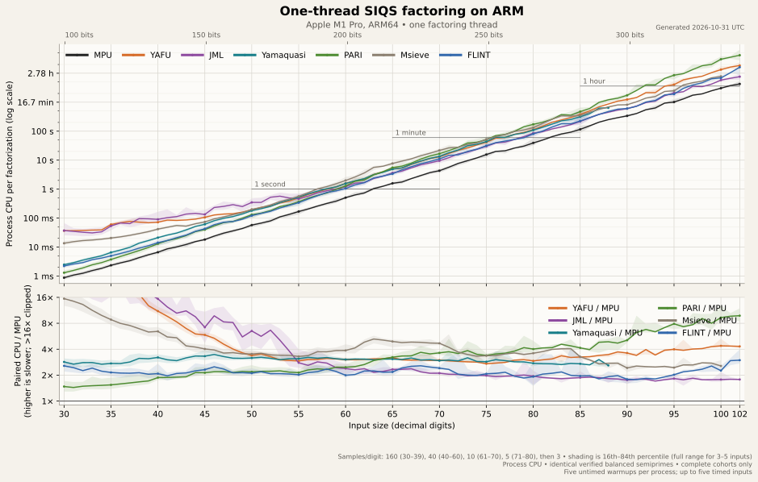
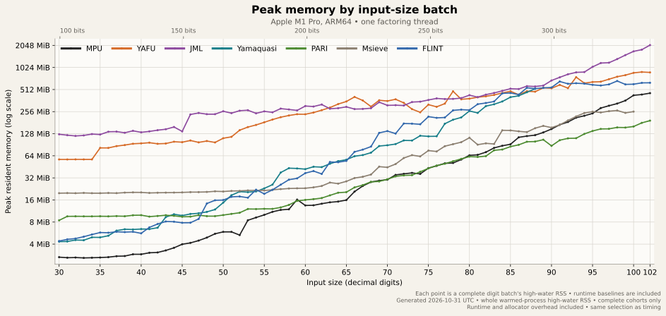
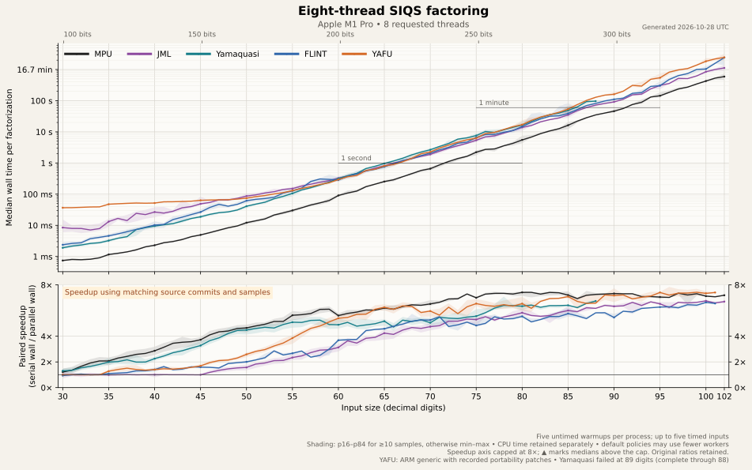
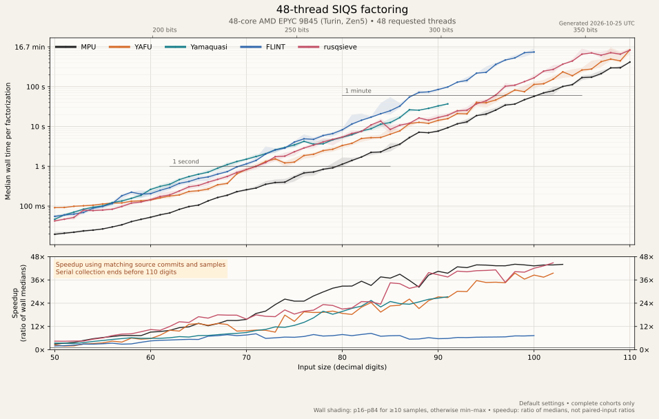
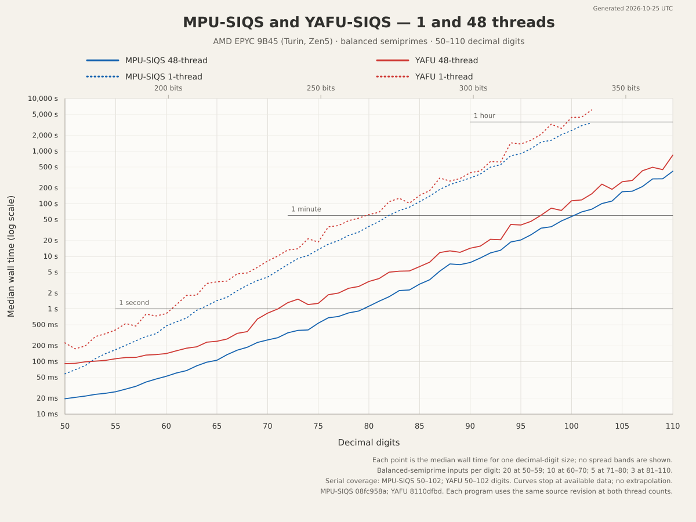

# Benchmarks

Quick graph index:

| Graph | Time | Memory | Description |
| :--- | :--- | :--- | :--- |
| 1-thread ARM64 | [time](graphs/siqs-external-single-thread.svg) | [memory](graphs/siqs-external-memory.svg) | 7 implementations, serial, Apple M1 Pro |
| 8-thread ARM64 | [time](graphs/siqs-external8.svg) | [memory](graphs/siqs-external8-memory.svg) | 5 implementations, 8 threads, Apple M1 Pro |
| 48-thread AMD | [time](graphs/siqs-c4d-48.svg) | [memory](graphs/siqs-c4d-48-memory.svg) | 5 implementations, 48 threads, AMD EPYC 9B45 |
| MPU/YAFU AMD | [time](graphs/siqs-yafu-wall-time-50-110.svg) | | MPU and Yafu times on AMD EPYC 9B45 |

Requested thread counts were limited to the available physical performance
cores.

## Details about the different SIQS implementations

Each implementation was frozen for benchmarking using the latest code I
could find at the time, with its default QS tuning parameters.  The
tested source revisions are listed below.  No changes were made other than
described in this paragraph.
Pari, YAFU, and Yamaquasi can be called with `factorint(n,14)`, `siqs(n)`,
and `--mode siqs` respectively to skip pretest work; JML, msieve, and FLINT
used small front end programs that skipped all pretests and directly called
their SIQS implementations.  YAFU 3.1.9 on x86 compiles with no changes,
but needed two minor changes to compile on macOS.

- [MPU](https://github.com/danaj/Math-Prime-Util-GMP/tree/master/siqs) is
  this project: a new C/GMP implementation of SIQS.  It uses no assembly
  and is very fast on both x86 and ARM64, and has good parallel scaling.
  We are using the standalone SIQS tool which doesn't utilize the general
  factoring tools of the larger module.

- [YAFU](https://github.com/bbuhrow/yafu) is an automated factoring suite,
  with highly optimized x86 sieving and NFS workflows as well as SIQS.
  It has been a go-to tool for high performance, high reliability,  and
  large factoring work since 2009.  It uses highly optimized asm vector
  kernels on x86, but has no ARM (NEON) kernels.

- [msieve](https://sourceforge.net/projects/msieve/), first released in 2004,
  is a complete library and command-line tool, with both QS and NFS work
  beyond this test.  It is hard to overstate how much impact Jason
  Papadopoulos' open source work has had on later projects.

- [PARI/GP](https://pari.math.u-bordeaux.fr/) supplies factoring as part
  of a broad, interactive number-theory system.  Pari/GP is a fixture for
  daily use for many people, and its factoring is excellent for mid-size
  numbers.  Its SIQS performs well at moderate sizes, though the source
  marks its larger-input parameter entries as “never tested.”  Its SIQS
  is not multi-threaded.

- [FLINT](https://flintlib.org/) provides quadratic sieving within a much
  larger C library for number theory and computer algebra.  Their SIQS
  seems to currently (October 2026) be in active refactoring.  It performs
  fairly well in serial but the version tested doesn't scale well to many
  threads.

- [JML](https://github.com/TilmanNeumann/java-math-library) offers carefully
  optimized serial and parallel SIQS in a Java number-theory library. Its
  work also provided useful ideas and comparisons during this project.
  The Java runtime presented some benchmark challenges, notably around
  memory use (the JVM acts quite differently from the lower-level projects),
  and in how the JIT performs.  This was the primary reason the smaller
  ARM results use warmups and factoring in batches, so the JIT has a chance
  to learn.  The use case will determine which method gives representative
  results (factoring one number or many).

- [yamaquasi](https://github.com/remyoudompheng/yamaquasi) is a modern Rust
  factoring library with Rust and Python interfaces. Its early parallel
  scaling is a useful point of comparison. The frozen versions failed on
  some larger test inputs, so their curves stop at the last completed range:
  88 digits on the Mac and 91 on AMD. This does not describe untested newer
  releases or every input of those sizes.

- [rusqsieve](https://github.com/metastable-void/rusqsieve), included in the
  AMD comparison, targets both native execution and threaded WebAssembly.
  Running a substantial sieve in a browser is an interesting accomplishment;
  the results here measure its native build, not its browser version.

Other notable implementations, not compared here:

- [cuda-mpqs](https://github.com/drjanosch42/cuda-mpqs) is a new
  comprehensive implementation of SIQS for GPUs.  It supports large
  inputs (512 bits), with very impressive performance on GPU clusters.
  Its GPU results are outside the scope of these CPU benchmarks.

- [siqs.net](https://github.com/JesHansen/siqs.net) is a C#/.NET
  implementation with a web interface that exposes the stages of the
  algorithm, along with distributed sieving across multiple machines.
  The version I tested was substantially slower than the selected group
  on timing checks, so I did not collect full benchmark data.
  Its integration of distributed sieve workers is a notable feature.
  These benchmarks measure performance on a single machine and do not
  exercise that capability.

- [C-Quadratic-Sieve](https://github.com/michel-leonard/C-Quadratic-Sieve)
  is another project aiming at readability and learning.  The version I
  tested was substantially slower than the selected group on timing checks,
  so I did not collect full benchmark data.

- [CADO-NFS](https://github.com/cado-nfs/cado-nfs) is the leading open
  source NFS implementation for CPUs.  It isn't included because these
  benchmarks are only comparing SIQS implementations.  Whether NFS is
  faster than SIQS for a given input is a different question.

<!-- ----------------------------------------------------------------------- -->

## Benchmarks on ARM

These comparisons are done on a 2021 Apple M1 Pro running macOS 26.4.1
and clang 21.0.0, rustc 1.99.1, and OpenJDK 25.
This machine has 8 'performance' cores and 2 'efficiency' cores, but we
do not use more than 8 threads for testing.
All implementations used their default QS tuning parameters.

Each process receives five unmeasured warmups, capped at 60 digits, followed
by at most five individually timed inputs. A fresh process is then started
for the next batch. The same inputs and sample counts are used across
programs; startup, warmups, and factor verification are outside the timers.
Shading shows input variation, not a confidence interval.

This is a benchmark of SIQS, not the complete factoring capabilities of the
package, nor does it measure quality, reliability, or ease of use.  Inputs
were balanced semiprimes.

### Single thread ARM times

Includes MPU-SIQS (de719ad0/9975fe1b), YAFU 3.1.9 (963dbe9c),
JML 1.4.0 (088d01fa), yamaquasi 0.3 (3f95f436), msieve 1.54 (r1099-trunk),
FLINT 3.7.0-dev (26b9bc9d), and PARI/GP 2.18.1 (1d7bcd2a) with
2.20.0 (d1430f50) for 93+ digits.
For this graph we show CPU time rather than wall time, though the latter is
recorded for calculating parallel speedup in the parallel benchmarks.

[Open the full-size timing graph](graphs/siqs-external-single-thread.svg)

MPU has the lowest median CPU time at every measured input size.  JML,
Yafu, and msieve have a larger gap with smaller inputs, possibly reflecting
QS designed for use after other factoring methods have handled easier cases.

At the upper end, JML becomes a strong competitor, with FLINT and msieve
also relatively close. These curves overlap considerably in the timing
graph -- the ratio panel makes things easier to see.  Pari is quite usable
across much of the range, though its times rise at larger sizes (the source
has a comment saying sizes over 91 digits are "untested").  YAFU uses its
generic sieve core on the Mac.

### Single thread ARM peak memory

<!--

-->

[ARM serial memory graph](graphs/siqs-external-memory.svg)

Peak resident memory accounts for the entire process, not just the structures
used by SIQS.  That includes runtime, warm-up, library, and allocator costs.
The Mac memory points are the maximum RSS observed across the warmed
processes for a complete method/digit batch.  This was deemed fairest for
the small inputs and for Java.  The AMD graphs below instead show medians of
individual processes' peak RSS, so the two are not directly comparable.

MPU-SIQS uses 32-bit linear-algebra indices, packed relation factor
vectors, and growing blocks of raw relation storage.  Keeping allocations
compact and avoiding unnecessary copies matters alongside the number of
partials retained.  Factor-base indices and exponents are packed together,
while large-prime labels retain their own wider representation.

### 8-thread ARM times

Includes MPU-SIQS (de719ad0/9975fe1b), YAFU 3.1.9 (963dbe9c),
JML 1.4.0 (088d01fa), yamaquasi 0.3 (3f95f436), and FLINT 3.7.0-dev (26b9bc9d).
The quadratic sieve implementations in PARI/GP and msieve are single threaded.

For this graph we show wall time, with parallel speedup calculated per
identical input processed by an identical executable as
**serial wall / parallel wall**.  Each plotted speedup is the median of
those per-input ratios.  Shading shows the 16th–84th percentiles when
there are at least 10 inputs, and the full observed range for smaller
sample groups.

The [eight-thread Mac comparison](graphs/siqs-external8.svg) shows both
elapsed factoring time and speedup relative to each program's own serial
elapsed time. Its [memory graph](graphs/siqs-external8-memory.svg) is
separate.

<!-- ----------------------------------------------------------------------- -->

## Benchmarks on AMD (x86)

These comparisons are done on Google Cloud Engine C4D instances.  The 48-core
measurements used a `c4d-highcpu-96` in us-central1-b.  These are shared
'cloud optimized' AMD EPYC 9B45 running on a hypervisor, not bare metal.
This is a Zen5 processor and includes SSE41, AVX2, AVX-512-BW, AVX-512-IFMA.
They use Ubuntu 24.04, gcc 13.3.0, rustc 1.99.0.
All implementations used their default QS tuning parameters.

The AMD results use different methodology and cannot be directly compared
to the ARM results.  Different inputs, different builds, and one fresh
process per input, including startup and adapter overhead, and no warmups.

All programs were run with identical benchmark queues on a single thread
running on a small instance, then with 48 threads requested on a large
instance.  CPU time, wall time, and Peak RSS were recorded for each input.
This is a much easier process than the one used on the Mac, but is less
appropriate for the smaller 30-digit inputs used there, and programs with
higher startup costs (e.g. JML, Pari/GP).

### 48-thread AMD times

Includes MPU-SIQS (66aa8ab8), YAFU 3.1.9 (8110dfbd), rusqsieve 0.5.0 (4b150834),
yamaquasi 0.3 (181e282c), and FLINT 3.7.0-dev (26b9bc9d).

For this graph we show wall time, with parallel speedup calculated as
**serial median wall / parallel median wall**.  Shading shows the 16th–84th
percentiles when there are at least 10 inputs, and the full observed range
for smaller sample groups.

The [AMD 48-core timing graph](graphs/siqs-c4d-48.svg) and the
[AMD 48-core memory graph](graphs/siqs-c4d-48-memory.svg) give a
fairer comparison with programs that have x86 optimizations
(YAFU and rusqsieve).

The results show MPU-SIQS runs substantially faster than the other
programs tested.  The next section will look closer at how YAFU compares
and examine why, as this was not expected.
The tested FLINT version distributes polynomials from a shared A family
across workers, while the other implementations here distribute A families.
Updating and copying polynomial data occurs under a shared lock, which
likely contributes to its limited scaling at 48 threads.

## YAFU and MPU

After looking at the earlier results and getting confirmation that others could
see similar results with their builds, I ran RSA-100 in serial with performance
monitoring as:

- MPU-SIQS (4d12949b) &nbsp; `./msiqs -t 1 $RSA100`
- YAFU (8110dfbd) &emsp;&emsp;&emsp; `./yafu -threads 1 "siqs($RSA100)"`

to get a better idea of why MPU-SIQS was running faster than YAFU.  In the
unprofiled control runs, MPU-SIQS took 1685s wall time while YAFU took 3828s.

We verified YAFU is using the AVX512BW 32k sieve kernel.
The software is very different in many ways, so it's expected that they would
make different parameter choices.  YAFU uses a larger factor base, a larger
sieve interval, q ~ 13 vs our 12, etc.  We process more families and more
polynomials, but the smaller factor base means we need to collect roughly
half the usable relations.

In this RSA-100 comparison, most of the timing difference was in sieving
and root preparation.  YAFU spent substantial time constructing and updating
buckets, while MPU used direct sieve kernels.  The different parameter
choices also affected the amount of work.

I’ve shared these profiling results with Ben Buhrow.  His work on YAFU has
been an important source of ideas for MPU-SIQS, and I’m looking forward to
seeing what comes next.

I also note that over a year ago, a
[post on mersenneforum](https://www.mersenneforum.org/node/1079832#post1079832)
detailed how YAFU was run in TLP mode with non-default parameters to
efficiently factor 100, 110, 120, 130, 140, and 150 digit inputs.  The
150-digit result is an amazing feat and, to my knowledge,  remains the
largest published CPU-only quadratic-sieve factorization.  These are
impressive results at sizes beyond this comparison.  Our benchmarks cover
default QS settings on specific machines and inputs.  YAFU is a much
broader factoring toolkit, including NFS, with over 15 years of use
across varied hardware, inputs, and workflows behind it. That experience
represents strengths a timing graph cannot capture.
