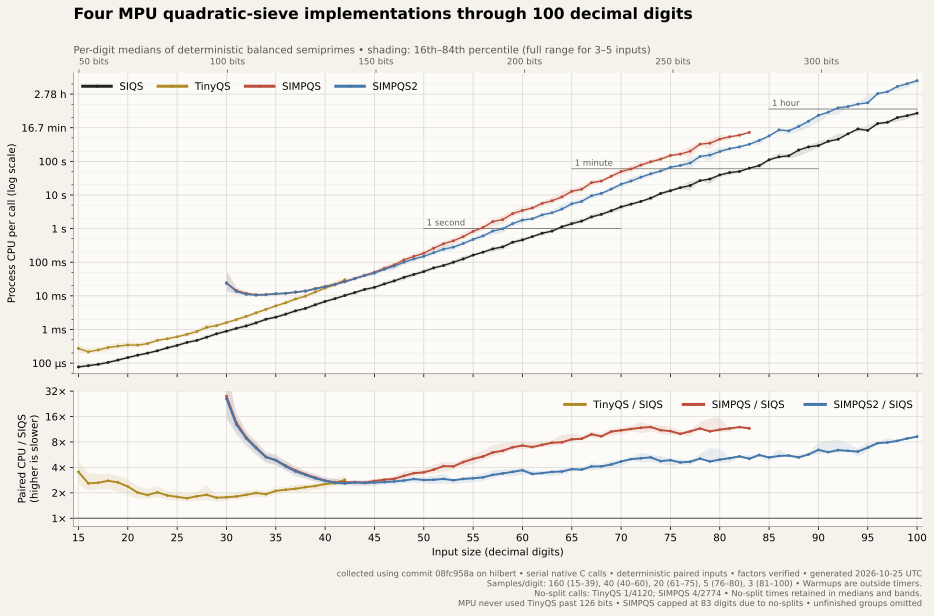

# Evolution of quadratic sieving in MPU-GMP

[Open the full-size evolution graph](graphs/siqs-evolution.svg)

This graph compares four implementations that have lived in MPU-GMP:

- **TinyQS**, a compact older implementation for small inputs.
- **SIMPQS**, the production quadratic sieve used since 2013.
- **SIMPQS2**, an experimental intermediate implementation.
- **SIQS**, the new production implementation.

Measurements were run on a quiet M1 MacBook ('hilbert' in the graph), using
deterministic balanced semiprimes, identical paired inputs, and direct
native C calls in one frozen executable.
They exclude Perl startup and the general `factor` strategy.
Warmups and verification are outside the timers.
The upper panel shows median process CPU time per call on a logarithmic scale.
Shading shows the 16th–84th percentiles, or the full range for groups of
three to five inputs.  The lower panel shows paired CPU ratios relative
to SIQS, capped at 32×.

SIMPQS, adapted from William Hart's 2006 implementation, supplied the
module's quadratic sieving for more than a decade.  TinyQS, added in 2017
from Ben Buhrow's cofactorization code, provided fast, more consistent
factoring for 65–126-bit inputs, including inputs below SIMPQS’s minimum
size.

My 2013 port incorporated some SIMPQS 2.0 changes, but omitted
partial-relation combining and block Lanczos, which limited its
performance on larger inputs.
That original version still gave us practical factoring in the
30-75 digit range even if it wasn't perfect, so "write our own QS"
languished on my TODO list for a decade.

In 2024, Hugo van der Sanden completed a port of SIMPQS2 and submitted it
as a pull request.  He reminded me in August of 2026 that I'd put it off
too long.  I integrated SIMPQS2 into master, made a few minor changes,
and it worked fine -- much better than the original.  His work addressed
all my concerns from 2013 with the original SIMPQS 2.0 code for our use.
Hugo’s work was invaluable: it finally prompted me to write the SIQS I
had long been considering.  The new implementation handles both small
and large inputs.
SIMPQS2 never appeared in a released version of MPU-GMP.  For version 0.55,
SIQS is intended to replace SIMPQS, SIMPQS2, and TinyQS.

Separately, Math::Prime::Util's native XS backend has a `tinysiqs128`
implementation on compilers with unsigned 128-bit integer support. That
implementation is distinct from the older TinyQS plotted here.

The curves have different coverage.
TinyQS above 126 bits was never used by `factor()`.
We stopped collecting SIMPQS results at 83 digits after
encountering inputs it could not split.
SIQS and SIMPQS2 collection is complete through 100 digits.
SIMPQS2’s parameter table extends through 91 digits.  Hugo’s pull
request noted that the inherited fallback parameters for larger
inputs were incorrect, so we retained the 91-digit endpoint settings
without additional tuning.
SIMPQS2 successfully factored every benchmark input through 100 digits.

The older implementations can sometimes return without successfully
factoring the input.
Those calls are recorded, and their times remain in the medians and
percentile bands; the counts are shown below the graph.
Successful results have their factors and product checked.
A few misses among thousands of small calls are different from
failing to split one of only three large samples, which is marked
separately when present.

## Memory use

The [memory graph](graphs/siqs-evolution-memory.svg) shows maximum
observed process RSS for each implementation and digit size, including
runtime and allocator overhead.

## Benchmark methodology

Measurements were collected in October 2026 on "hilbert", an Apple M1
MacBook with 16 GiB RAM.  All four implementations were included in one
frozen native C executable, using MPU-GMP source revision
`08fc958a4bf8bd66b4316ee9962a74164d8eeaaf`.  It was built for serial
execution with Apple Clang 21.0.0, `-O3`, and statically linked GMP 6.3.0.

Inputs were deterministic balanced semiprimes constructed from distinct
primes proved offline. Inputs span the possible bit lengths within each
decimal-digit range. Each implementation received identical inputs within
its measured range.

| Digits | inputs per digit |
| ---: | ---: |
| 15-39 | 160 |
| 40-60 |  40 |
| 61-75 |  20 |
| 76-80 |   5 |
| 81-100|   3 |

Each collection batch used a fresh process for one implementation and digit
size.  Before measurement, the implementation was warmed for at least 0.25
CPU seconds using a fixed 30-digit input.  Each measured sample then made
one direct C call.  Timing includes the implementation’s internal
allocations, while excluding process startup, input parsing, warmup, and
result verification.

Returned factors were checked against the proved input factors and their
product.
The benchmark did not use another algorithm to rescue unsuccessful calls.

## Lineage and perspective

Quadratic sieving rests on decades of published number theory and practical
engineering. Earlier implementations by Jason Papadopoulos, Ben Buhrow,
William Hart, Tilman Neumann, and others provided important ideas and points
of comparison. The SIQS and Lanczos source headers give more specific
acknowledgments and references. In particular, the block Lanczos solver
follows [Peter Montgomery's published algorithm](https://doi.org/10.1007/3-540-49264-X_9)
and acknowledges the influence of Papadopoulos's implementation.

I have developed Math::Prime::Util and its GMP backend since 2012,
following earlier work on integer factoring.  For SIQS, I worked
extensively with OpenAI Codex to discuss algorithms, implement ideas,
review code, debug problems, and run experiments.
